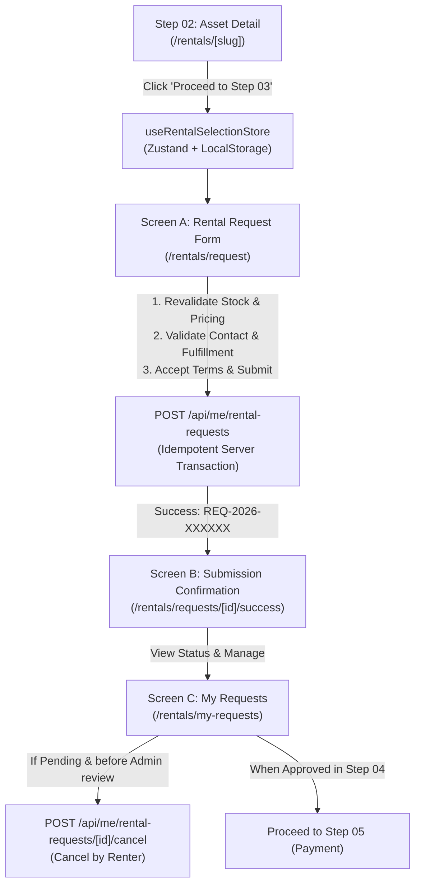

# Step 03: Submit a Rental Request — Architecture & Implementation Plan

> **Document Status:** Awaiting User Review & Approval  
> **Target Module:** Step 03 of 11 — Asset Rental Management System  
> **Source Specification:** [`docs/Asset_Rental_Step_03_Submit_Rental_Request_Implementation_Spec.md`](file:///c:/Project/asset-rental/docs/Asset_Rental_Step_03_Submit_Rental_Request_Implementation_Spec.md)  
> **Upstream Dependency:** Step 02 (`/rentals/[slug]` asset selection, availability, quote preview)  
> **Downstream Hand-off:** Step 04 (Admin Review & Approval)

---

## 1. Executive Summary & Objective

In **Step 02**, the customer browsed equipment, selected dates and quantity, verified real-time availability, and generated an indicative server quote preview.

**Step 03** creates an immutable, legally binding, durable commercial request in the state of `PENDING_APPROVAL`. It captures:
- **Who** wants to rent (authenticated renter identity, legal name, phone, email, optional organization).
- **What** & **How many** (asset listing, requested units count).
- **When** (validated start and return date/time in UTC).
- **Where** (pickup location or verified delivery address).
- **Which Commercial Terms** (server-recalculated immutable snapshot: rental rate, deposit, delivery fee, taxes, total, contingent late return fees).
- **Consent** (explicit, un-prechecked acceptance of Terms & Rental Policy).

> [!IMPORTANT]
> **Core Tenet:** A submitted request is **not** a guaranteed booking. It is placed in `PENDING_APPROVAL` (never `APPROVED` or `RESERVED`). No credit card is charged, and inventory units are not locked until Step 04 (Admin Approval) and Step 05/06 (Payment & Confirmation).

---

## 2. System Flow Integration & User Journey



### Transition from Step 02
1. On [`src/app/rentals/[slug]/page.tsx`](file:///c:/Project/asset-rental/src/app/rentals/[slug]/page.tsx), the confirmation dialog currently displays *"Proceed to Step 03"*.
2. Clicking this button persists the selection into `useRentalSelectionStore` and navigates directly to `/rentals/request`.
3. If a user visits `/rentals/request` without an active selection, an empty-state card prompts them to browse equipment and redirects to `/rentals`.

---

## 3. Database Schema Delta (`prisma/schema.prisma`)

We will extend [`prisma/schema.prisma`](file:///c:/Project/asset-rental/prisma/schema.prisma) with 5 dedicated models:

```prisma
// ============================================================================
// STEP 03: RENTAL REQUEST & COMMERCIAL SNAPSHOT MODELS
// ============================================================================

model RentalRequest {
  id               String   @id @default(cuid())
  requestNo        String   @unique // e.g. "REQ-2026-000001"
  renterId         String
  listingId        String
  companyId        String
  status           String   @default("PENDING_APPROVAL") 
  // Statuses: "DRAFT" | "PENDING_APPROVAL" | "APPROVED_AWAITING_PAYMENT" | "REJECTED" | "CANCELLED_BY_RENTER"

  // Interval & Quantity
  startAt          DateTime
  endAt            DateTime
  rentalDays       Int
  quantity         Int      @default(1)

  // Fulfillment
  fulfillment      String   @default("PICKUP") // "PICKUP" | "DELIVERY"
  pickupLocationId String?
  returnLocationId String?

  // Contact Information
  contactName      String
  contactPhone     String
  contactEmail     String
  organizationName String?

  // Customer Notes & Preferences
  customerNotes    String?

  // Idempotency & Audit
  idempotencyKey   String?
  quoteToken       String?
  submittedAt      DateTime @default(now())
  createdAt        DateTime @default(now())
  updatedAt        DateTime @updatedAt

  // Relationships
  renter           User                  @relation(fields: [renterId], references: [id])
  listing          AssetListing          @relation(fields: [listingId], references: [id], onDelete: Cascade)
  company          RentalCompany         @relation(fields: [companyId], references: [id], onDelete: Cascade)
  pickupLocation   AssetLocation?        @relation("RequestPickupLoc", fields: [pickupLocationId], references: [id])
  returnLocation   AssetLocation?        @relation("RequestReturnLoc", fields: [returnLocationId], references: [id])
  quoteSnapshot    RentalQuoteSnapshot?
  deliveryAddress  RentalRequestAddress?
  termsAcceptance  RentalTermsAcceptance?
  events           RentalRequestEvent[]

  @@index([renterId, status])
  @@index([companyId, status])
  @@index([requestNo])
}

model RentalQuoteSnapshot {
  id                    String   @id @default(cuid())
  requestId             String   @unique
  currency              String   @default("USD")
  billingUnit           String   @default("DAY")
  unitRate              Float
  rentalDays            Int
  quantity              Int      @default(1)
  rentalSubtotal        Float
  securityDeposit       Float    @default(0)
  deliveryFee           Float    @default(0)
  estimatedTax          Float    @default(0)
  totalPayable          Float
  contingentLateFee     Float    @default(0)
  contingentLateFeeUnit String   @default("DAY")
  capturedAt            DateTime @default(now())

  request               RentalRequest @relation(fields: [requestId], references: [id], onDelete: Cascade)
}

model RentalRequestAddress {
  id             String   @id @default(cuid())
  requestId      String   @unique
  recipientName  String
  recipientPhone String
  addressLine1   String
  addressLine2   String?
  city           String
  postalCode     String?
  deliveryNotes  String?

  request        RentalRequest @relation(fields: [requestId], references: [id], onDelete: Cascade)
}

model RentalTermsAcceptance {
  id             String   @id @default(cuid())
  requestId      String   @unique
  termsVersionId String   @default("rental-terms-2026.1")
  acceptedAt     DateTime @default(now())
  actorId        String
  ipAddress      String?

  request        RentalRequest @relation(fields: [requestId], references: [id], onDelete: Cascade)
}

model RentalRequestEvent {
  id        String   @id @default(cuid())
  requestId String
  actorId   String
  actorName String
  actorType String   @default("RENTER") // "RENTER" | "ADMIN" | "SYSTEM"
  action    String   // "SUBMIT" | "CANCEL" | "APPROVE" | "REJECT"
  fromStatus String?
  toStatus  String
  reason    String?
  createdAt DateTime @default(now())

  request   RentalRequest @relation(fields: [requestId], references: [id], onDelete: Cascade)

  @@index([requestId])
}
```

---

## 4. Proposed API Endpoints

### 1. `POST /api/me/rental-requests`
Submits a new rental request with strict server-side validation.
- **Headers:** `Idempotency-Key: <UUID>`
- **Payload:**
  ```json
  {
    "listing_id": "listing_cm...",
    "start_at": "2026-10-25T09:00:00.000Z",
    "end_at": "2026-10-28T09:00:00.000Z",
    "quantity": 1,
    "fulfillment": "PICKUP",
    "pickup_location_id": "loc_01",
    "return_location_id": "loc_01",
    "contact_name": "Sophea Chan",
    "contact_phone": "+855 12 345 678",
    "contact_email": "sophea@example.com",
    "organization_name": "Phnom Penh Media Lab",
    "customer_notes": "Please include lens caps and spare battery.",
    "quote_token": "QT-MH49-...",
    "terms_accepted": true,
    "terms_version_id": "rental-terms-2026.1",
    "delivery_address": {
      "recipient_name": "Sophea Chan",
      "recipient_phone": "+855 12 345 678",
      "address_line1": "Street 240, Daun Penh",
      "city": "Phnom Penh",
      "delivery_notes": "Ring doorbell at gate"
    }
  }
  ```
- **Server Verification Rules:**
  1. **Idempotency check:** If `(renterId, idempotencyKey)` exists, return existing request immediately without re-creation.
  2. **Active Renter check:** Authenticate current user via `getCurrentUser()`.
  3. **Listing & Stock check:** Ensure listing exists and is `PUBLISHED`. Verify available active units during `[startAt, endAt]`.
  4. **Rate calculation:** Recalculate subtotal, security deposit, delivery fee, and total payable on the server. Reject or ignore any client-supplied totals.
  5. **Request Number generator:** Generates formatted sequence: `REQ-2026-XXXXXX`.
  6. **Atomic Transaction:** Saves `RentalRequest`, `RentalQuoteSnapshot`, `RentalRequestAddress`, `RentalTermsAcceptance`, and logs the initial `RentalRequestEvent`.

### 2. `GET /api/me/rental-requests`
Lists all rental requests for the authenticated user.
- **Query Params:** `?status=ALL | PENDING_APPROVAL | APPROVED_AWAITING_PAYMENT | REJECTED | CANCELLED_BY_RENTER`
- **Returns:** Array of requests with listing summaries, dates, status badges, and total quote snapshots.

### 3. `GET /api/me/rental-requests/[id]`
Fetches complete details for a single rental request owned by the user.
- **Returns:** Request details, listing details, pickup/delivery info, commercial snapshot, and full audit event timeline.

### 4. `POST /api/me/rental-requests/[id]/cancel`
Allows a renter to withdraw a request while it is still in `PENDING_APPROVAL`.
- **Payload:** `{ "reason": "Dates no longer work" }`
- **Validation:** Only permits cancellation if `status === 'PENDING_APPROVAL'`.
- **Transitions:** Changes status to `CANCELLED_BY_RENTER` and appends an audit event in `RentalRequestEvent`.

---

## 5. UI Architecture & Screen Designs

We will build the screens in accordance with the existing emerald/slate aesthetic, clean cards, modern typography, responsive layout, and Lucide icons:

### Screen A: Rental Request Form (`src/app/rentals/request/page.tsx`)
- **Breadcrumb & Header:** `Home > Rentals > [Asset Name] > Rental Request`
- **Layout:** 2-Column Responsive Layout:
  - **Left Column (7 cols):**
    1. **Asset Summary Card:** Thumbnail, asset name, asset code, category badge, quantity badge, and an *"Edit Selection"* link to return to `/rentals/[slug]`.
    2. **Rental Schedule Card:** Calendar dates, start/end time, duration in days, timezone indicator.
    3. **Fulfillment Selection Card:**
       - Toggle between **Pickup at Location** and **Delivery to Address**.
       - If Pickup: Location selector displaying hub address and operating hours.
       - If Delivery: Recipient name, phone, street address, city, and delivery instructions.
    4. **Renter Information Card:** Pre-filled name, email, contact phone, and optional organization.
    5. **Special Instructions / Notes Card:** Optional rental purpose or handling requests (bounded to 500 characters).
    6. **Terms & Agreements Card:** Explicit, un-prechecked checkbox acknowledging the Rental Agreement and Cancellation Policy, with clickable view dialogs.
  - **Right Column (5 cols, Sticky Sidebar):**
    - **Indicative Quote Card:**
      - Daily Rate × Days × Quantity
      - Security Deposit (refundable)
      - Delivery Fee
      - Estimated Total Payable
      - Badge: *"Estimate — Pending Approval"*
      - Contingent late fees disclosure.
    - **Submit Button:** Emerald green, loading spinner on click, double-click prevention via `disabled` state and unique idempotency key.

### Screen B: Submission Confirmation (`src/app/rentals/requests/[id]/success/page.tsx`)
- **Hero Banner:** Checkmark animation, request number (e.g. `REQ-2026-000001`), and `PENDING_APPROVAL` status badge.
- **Clear Status Disclosure:** *"Your rental request has been submitted for company review. No payment has been taken and equipment is not reserved until approved by admin."*
- **SLA & Next Steps Timeline:**
  1. Step 03: Request Submitted (Completed).
  2. Step 04: Admin Review (Within 2–4 business hours).
  3. Step 05: Payment & Deposit (Upon approval).
  4. Step 06: Reservation Confirmed.
- **Action Buttons:**
  - *"Go to My Requests"* (`/rentals/my-requests`)
  - *"Cancel Request"* (interactive dialog with reason prompt)
  - *"Browse More Equipment"* (`/rentals`)

### Screen C: Customer "My Requests" (`src/app/rentals/my-requests/page.tsx`)
- **Tabs:** `All Requests`, `Pending Approval`, `Approved (Awaiting Payment)`, `Completed / Cancelled`.
- **Card Elements:**
  - Equipment image & title.
  - Request ID & submission date.
  - Dates and duration.
  - Fulfillment badge (Pickup vs Delivery).
  - Estimated total quote.
  - Status Badge (`PENDING_APPROVAL`, `APPROVED_AWAITING_PAYMENT`, `CANCELLED_BY_RENTER`, `REJECTED`).
  - Action buttons: "View Details", "Cancel Request" (if pending), "Proceed to Payment" (if approved).

### Navigation Update (`src/components/rental/Header.tsx`)
- Add **"My Requests"** link into the desktop navigation bar and mobile drawer menu so renters can quickly navigate to their rental dashboard.

---

## 6. UAT Scenarios (Step 03 Compliance Matrix)

| ID | Scenario | Expected Behavior |
|:---|:---|:---|
| **R01** | Guest clicks request without selection | Redirects gracefully to `/rentals` with a friendly prompt |
| **R02** | Signed-in user submits valid form | Creates 1 request in `PENDING_APPROVAL` with `REQ-2026-XXXXXX` |
| **R03** | Rapid double-click on submit | Idempotency key prevents duplicate; returns original request |
| **R04** | Invalid end date before start date | Form validation highlights invalid fields, prevents submit |
| **R05** | Availability conflict before submission | Server checks stock; returns 409 error with clear explanation |
| **R06** | Rate modified in database before submit | Server recalculates against current active rate snapshot |
| **R07** | Client tampering with price payload | Server ignores client totals; calculates true total from DB |
| **R08** | Unchecked terms agreement | Submit button disabled or form validation blocks submission |
| **R09** | Delivery outside permitted area | Validates address and delivery availability |
| **R10** | Pickup option selected | Enforces valid pickup location selection |
| **R11** | User cancels pending request | Transitions to `CANCELLED_BY_RENTER`, records audit event |
| **R12** | User attempts to access another user's request | API returns 403 / 404 forbidden response |
| **R13** | Refresh success page | Renders request state without duplicating record |
| **R14** | Mobile viewport display | Sticky footer with total estimate and submit action |
| **R15** | Special characters in notes | Unicode and quotes sanitized and stored safely |

---

## 7. Implementation Execution Roadmap

1. **Step 1: Database Migration**
   - Update `prisma/schema.prisma` with the 5 new models and relationships.
   - Run `npx prisma db push` and `npx prisma generate`.
2. **Step 2: API Route Implementation**
   - Implement `src/app/api/me/rental-requests/route.ts` (POST create, GET list).
   - Implement `src/app/api/me/rental-requests/[id]/route.ts` (GET single).
   - Implement `src/app/api/me/rental-requests/[id]/cancel/route.ts` (POST cancel).
3. **Step 3: Frontend Pages Implementation**
   - Create `/rentals/request` (`src/app/rentals/request/page.tsx`).
   - Create `/rentals/requests/[id]/success` (`src/app/rentals/requests/[id]/success/page.tsx`).
   - Create `/rentals/my-requests` (`src/app/rentals/my-requests/page.tsx`).
4. **Step 4: Step 02 to Step 03 Handoff Connection**
   - Update `src/app/rentals/[slug]/page.tsx` so "Proceed to Step 03" redirects to `/rentals/request`.
   - Update `src/components/rental/Header.tsx` to add "My Requests".
5. **Step 5: End-to-End Verification & Testing**
   - Run test flow: Browse -> Select dates -> Proceed -> Submit Request -> Verify Success -> View in My Requests -> Test Cancel.
   - Verify all UAT rules.

---

Please review this implementation plan. Once you confirm, we will proceed immediately with Step 1 of the implementation!
