# RentHub Enterprise Asset Rental — Complete Database Specification & ERD

## 1. Database Architecture Overview

RentHub utilizes an enterprise-grade relational schema managed by **Prisma ORM (v6)** running on **SQLite** (located at `db/custom.db`). The architecture tracks physical equipment from initial cataloging, serialized unit barcoding, dynamic pricing, customer request approval, automated inventory holds, multi-channel payment capture, dispatch/handover custody, active extensions/incidents, return intake, damage inspection, security deposit settlement, and final closure into maintenance.

- **Engine:** SQLite 3 (via Prisma Client v6)
- **Database URL:** `file:../db/custom.db`
- **Total Tables / Models:** 30
- **Isolation:** Multi-tenant ready (`RentalCompany` foreign key anchoring), role-based identity separation (`User.role`), serialized individual equipment tagging (`AssetUnit`).

---

## 2. Complete Entity Relationship Diagram (ERD)

```mermaid
erDiagram
    %% Core Identity & Tenancy
    User ||--o{ Booking : "makes"
    User ||--o{ Review : "writes"
    User ||--o{ RentalRequest : "submits"
    User ||--o{ RentalReservation : "holds"

    RentalCompany ||--o{ AssetLocation : "operates"
    RentalCompany ||--o{ AssetListing : "owns"
    RentalCompany ||--o{ AssetAuditEvent : "records"
    RentalCompany ||--o{ RentalRequest : "receives"

    %% Catalog & Inventory
    AssetCategory ||--o{ AssetCategory : "subcategories"
    AssetCategory ||--o{ AssetListing : "classifies"
    AssetBrand ||--o{ AssetListing : "brands"

    AssetListing ||--o{ AssetUnit : "serializes"
    AssetListing ||--o{ AssetRate : "prices"
    AssetListing ||--o| AssetRentalPolicy : "governs"
    AssetListing ||--o{ AssetLocationOption : "avail_at"
    AssetListing ||--o{ AssetBlockedInterval : "blocks"
    AssetListing ||--o{ AssetAuditEvent : "audits"
    AssetListing ||--o{ RentalRequest : "requested_in"
    AssetListing ||--o{ RentalInventoryHold : "held_for"
    AssetListing ||--o{ RentalReservationLine : "reserved_in"
    AssetListing ||--o{ Booking : "booked_in"
    AssetListing ||--o{ Review : "reviewed_in"

    AssetLocation ||--o{ AssetUnit : "stores"
    AssetLocation ||--o{ AssetLocationOption : "supports"
    AssetLocation ||--o{ RentalRequest : "pickup_loc"
    AssetLocation ||--o{ RentalRequest : "return_loc"
    AssetLocation ||--o{ RentalReservation : "located_at"
    AssetLocation ||--o{ RentalFulfillmentTask : "prepares_at"

    AssetUnit ||--o{ AssetBlockedInterval : "blackouts"
    AssetUnit ||--o{ Booking : "allocated_to"
    AssetUnit ||--o{ RentalHoldUnit : "locked_in"
    AssetUnit ||--o{ RentalUnitAllocation : "dispatched_in"
    AssetUnit ||--o{ RentalHandoverItem : "handed_over"
    AssetUnit ||--o{ RentalInspectionItem : "inspected_in"
    AssetUnit ||--o{ RentalMaintenanceTask : "maintained_by"

    %% Step 03: Request & Snapshots
    RentalRequest ||--o| RentalQuoteSnapshot : "freezes_quote"
    RentalRequest ||--o| RentalRequestAddress : "delivers_to"
    RentalRequest ||--o| RentalTermsAcceptance : "signed_terms"
    RentalRequest ||--o{ RentalRequestEvent : "logs_lifecycle"
    RentalRequest ||--o| RentalInventoryHold : "locks_stock"
    RentalRequest ||--o{ RentalApprovalDecision : "reviewed_by"
    RentalRequest ||--o{ RentalChangeProposal : "counter_offered"
    RentalRequest ||--o| RentalPaymentOrder : "bills"
    RentalRequest ||--o| RentalDepositLedger : "tracks_deposit"
    RentalRequest ||--o| RentalReservation : "confirmed_into"

    %% Step 04: Holds
    RentalInventoryHold ||--o{ RentalHoldUnit : "locks_units"

    %% Step 05: Payments
    RentalPaymentOrder ||--o{ RentalPaymentAttempt : "attempts"
    RentalPaymentOrder ||--o| RentalPaymentReceipt : "issues_receipt"

    %% Step 06: Reservation & Fulfillment
    RentalReservation ||--o{ RentalReservationLine : "contains_items"
    RentalReservation ||--o| RentalFulfillmentTask : "staged_by"
    RentalReservation ||--o{ RentalReservationEvent : "timeline"
    RentalReservation ||--o| RentalHandover : "dispatched_via"
    RentalReservation ||--o{ RentalEvidence : "photo_records"
    RentalReservation ||--o{ RentalExtensionRequest : "extends"
    RentalReservation ||--o{ RentalIncident : "incident_reports"
    RentalReservation ||--o| RentalReturnCase : "intakes"
    RentalReservation ||--o| RentalInspection : "quality_check"
    RentalReservation ||--o| RentalSettlement : "settles_deposit"
    RentalReservation ||--o| RentalClosure : "closes"

    RentalReservationLine ||--o{ RentalUnitAllocation : "allocates_units"
    RentalReservationLine ||--o{ RentalPoolAllocation : "allocates_pool"

    %% Step 07: Handover & Custody
    RentalHandover ||--o{ RentalHandoverItem : "items_handed"
    RentalHandoverItem ||--o{ RentalHandoverAccessory : "includes_acc"

    %% Step 09 & 10: Returns & Inspections
    RentalReturnCase ||--o| RentalReturnReceipt : "receipted_with"
    RentalInspection ||--o{ RentalInspectionItem : "item_evaluations"
```

---

## 3. Detailed Data Dictionary & Table Specifications

### Group A: Identity, Organization & Roles

#### 1. `User`
Stores system accounts for both end-user clients (renters) and internal administrators.

| Column | Type | Nullable | Default | Constraints / Relations | Description |
|---|---|---|---|---|---|
| `id` | `String` | No | `cuid()` | Primary Key | Unique user identifier |
| `email` | `String` | No | — | Unique Index | User email address for auth |
| `name` | `String` | No | — | — | Full name of client or staff |
| `avatar` | `String` | Yes | `null` | — | Profile picture URL |
| `phone` | `String` | Yes | `null` | — | Contact telephone number |
| `bio` | `String` | Yes | `null` | — | Personal or business bio |
| `passwordHash` | `String` | Yes | `null` | — | Scrypt/PBKDF2 salted password hash |
| `status` | `String` | No | `"ACTIVE"` | `"ACTIVE"` \| `"SUSPENDED"` | Account operational status |
| `lastLoginAt` | `DateTime` | Yes | `null` | — | Timestamp of most recent login |
| `role` | `String` | No | `"client"` | `"client"` \| `"admin"` \| `"owner"` | Access role (strict isolation) |
| `createdAt` | `DateTime` | No | `now()` | — | Record creation timestamp |
| `updatedAt` | `DateTime` | No | auto | — | Auto-updated timestamp |

#### 2. `RentalCompany`
Anchors multi-location enterprise business information, currency, and timezone configurations.

| Column | Type | Nullable | Default | Description |
|---|---|---|---|---|
| `id` | `String` | No | `cuid()` | Primary Key |
| `name` | `String` | No | `"RentHub Enterprise Rentals"` | Business operating brand name |
| `legalName` | `String` | Yes | `"RentHub Co., Ltd."` | Registered legal entity name |
| `currency` | `String` | No | `"USD"` | Default billing currency code |
| `timezone` | `String` | No | `"Asia/Phnom_Penh"` | System operating timezone |
| `phone` | `String` | Yes | `"+855 23 888 999"` | Customer support phone line |
| `email` | `String` | Yes | `"support@renthub.app"` | Business support email |
| `address` | `String` | Yes | `"Building 42, Norodom Blvd..."`| Headquarters physical address |
| `createdAt` | `DateTime` | No | `now()` | Creation timestamp |
| `updatedAt` | `DateTime` | No | auto | Update timestamp |

---

### Group B: Asset Catalog, Serialization & Fleet Management

#### 3. `AssetCategory`
Self-referencing tree model organizing catalog items into hierarchical categories.

| Column | Type | Nullable | Default | Constraints / Relations | Description |
|---|---|---|---|---|---|
| `id` | `String` | No | `cuid()` | Primary Key | Category identifier |
| `name` | `String` | No | — | — | Category display name |
| `slug` | `String` | No | — | Unique Index | URL-friendly unique slug |
| `shortDescription`| `String` | Yes | `null` | — | Concise preview blurb |
| `description` | `String` | Yes | `null` | — | Full rich-text description |
| `imageUrl` | `String` | Yes | `null` | — | Banner image URL |
| `iconName` | `String` | Yes | `"Folder"` | Lucide icon name | Icon name for UI rendering |
| `color` | `String` | Yes | `"#10B981"` | Hex color code | Brand accent color code |
| `parentId` | `String` | Yes | `null` | FK -> `AssetCategory(id)` | Parent category for hierarchy |
| `displayOrder` | `Int` | No | `0` | — | Sort order for display |
| `status` | `String` | No | `"ACTIVE"` | `"ACTIVE"`, `"INACTIVE"`, `"ARCHIVED"` | Visibility status |
| `metaTitle` | `String` | Yes | `null` | — | SEO page title |
| `metaDescription`| `String` | Yes | `null` | — | SEO meta description |
| `createdAt` | `DateTime` | No | `now()` | — | Record creation timestamp |
| `updatedAt` | `DateTime` | No | auto | — | Auto-update timestamp |

#### 4. `AssetBrand`
Manufacturers and brands of rental gear (e.g., Apple, Sony, DJI, Canon).

| Column | Type | Nullable | Default | Constraints | Description |
|---|---|---|---|---|---|
| `id` | `String` | No | `cuid()` | Primary Key | Brand identifier |
| `name` | `String` | No | — | Unique | Brand display name |
| `slug` | `String` | No | — | Unique | URL slug |
| `isActive` | `Boolean`| No | `true` | — | Active status toggle |
| `createdAt` | `DateTime` | No | `now()` | — | Created timestamp |
| `updatedAt` | `DateTime` | No | auto | — | Updated timestamp |

#### 5. `AssetLocation`
Physical hubs, warehouses, and customer collection/return counters.

| Column | Type | Nullable | Default | Constraints | Description |
|---|---|---|---|---|---|
| `id` | `String` | No | `cuid()` | Primary Key | Location identifier |
| `companyId` | `String` | No | — | FK -> `RentalCompany(id)` | Company ownership |
| `name` | `String` | No | — | — | Location name (e.g. HQ Central) |
| `code` | `String` | No | — | Unique | Short code (e.g. `LOC-PNH-01`) |
| `address` | `String` | No | — | — | Street address |
| `city` | `String` | No | — | — | City / Province |
| `timezone` | `String` | No | `"Asia/Phnom_Penh"` | — | Local operational timezone |
| `isPickupDefault`| `Boolean`| No | `true` | — | Default option for pickup |
| `isActive` | `Boolean`| No | `true` | — | Operational status |
| `createdAt` | `DateTime` | No | `now()` | — | Created timestamp |
| `updatedAt` | `DateTime` | No | auto | — | Updated timestamp |

#### 6. `AssetListing`
Master catalog definition for rentable items, containing images, specs, and policies.

| Column | Type | Nullable | Default | Constraints / Relations | Description |
|---|---|---|---|---|---|
| `id` | `String` | No | `cuid()` | Primary Key | Listing identifier |
| `companyId` | `String` | No | — | FK -> `RentalCompany(id)` | Owner company |
| `code` | `String` | No | — | Unique | Catalog SKU / Asset Code |
| `name` | `String` | No | — | — | Commercial item title |
| `slug` | `String` | No | — | Unique | Slug for public URLs |
| `categoryId` | `String` | No | — | FK -> `AssetCategory(id)` | Primary category |
| `brandId` | `String` | Yes | `null` | FK -> `AssetBrand(id)` | Brand manufacturer |
| `model` | `String` | Yes | `null` | — | Model number / name |
| `shortDescription`| `String` | No | — | — | Brief overview |
| `description` | `String` | Yes | `null` | — | Markdown full description |
| `specifications` | `String` | Yes | `null` | JSON String | Tech specs (RAM, CPU, Lens mount) |
| `trackingMode` | `String` | No | `"SERIALIZED"` | `"SERIALIZED"` \| `"QUANTITY"` | Inventory tracking mechanism |
| `conditionNote`| `String` | Yes | `null` | — | General condition disclaimer |
| `coverImage` | `String` | No | — | — | Primary hero photo URL |
| `images` | `String` | No | `"[]"` | JSON Array String | Gallery photo URLs |
| `allowDelivery` | `Boolean`| No | `true` | — | Delivery availability |
| `deliveryFee` | `Float` | No | `0` | — | Flat delivery surcharge |
| `visibility` | `String` | No | `"DRAFT"` | `"DRAFT"`, `"PUBLISHED"`, `"ARCHIVED"` | Visibility status |
| `publishedAt` | `DateTime` | Yes | `null` | — | Public release timestamp |
| `version` | `Int` | No | `1` | — | Optimistic locking counter |
| `rating` | `Float` | No | `0` | — | Aggregate customer rating |
| `reviewCount` | `Int` | No | `0` | — | Number of reviews |
| `createdAt` | `DateTime` | No | `now()` | — | Created timestamp |
| `updatedAt` | `DateTime` | No | auto | — | Updated timestamp |

#### 7. `AssetLocationOption`
Many-to-many junction mapping which locations support pickup/return for a specific listing.

| Column | Type | Nullable | Default | Constraints | Description |
|---|---|---|---|---|---|
| `id` | `String` | No | `cuid()` | Primary Key | Junction ID |
| `listingId` | `String` | No | — | FK -> `AssetListing(id)` | Asset listing |
| `locationId` | `String` | No | — | FK -> `AssetLocation(id)` | Warehouse location |
| `pickupEnabled` | `Boolean`| No | `true` | — | Allows customer pickup |
| `returnEnabled` | `Boolean`| No | `true` | — | Allows customer drop-off |

*Unique constraint on `[listingId, locationId]`.*

#### 8. `AssetUnit`
Serialized physical instances of equipment tracked by barcoded asset tags.

| Column | Type | Nullable | Default | Constraints | Description |
|---|---|---|---|---|---|
| `id` | `String` | No | `cuid()` | Primary Key | Physical unit identifier |
| `listingId` | `String` | No | — | FK -> `AssetListing(id)` | Parent catalog model |
| `assetTag` | `String` | No | — | Unique | Physical barcode/QR tag (`TO-LAP-001`) |
| `serialNumber` | `String` | Yes | `null` | — | OEM hardware serial number |
| `locationId` | `String` | No | — | FK -> `AssetLocation(id)` | Current physical location |
| `baseStatus` | `String` | No | `"ACTIVE"` | `"ACTIVE"`, `"MAINTENANCE"`, `"LOST"` | Fleet operational status |
| `conditionGrade`| `String` | No | `"GOOD"` | `"NEW"`, `"EXCELLENT"`, `"GOOD"`, `"FAIR"` | Physical condition tier |
| `accessories` | `String` | Yes | `null` | — | Included items (Charger, Case) |
| `conditionPhotos`| `String`| Yes | `null` | JSON Array String | Inspection proof URLs |
| `purchaseDate` | `DateTime` | Yes | `null` | — | Procurement date |
| `purchaseCost` | `Float` | Yes | `null` | — | Procurement expense (confidential) |
| `notes` | `String` | Yes | `null` | — | Internal staff notes |
| `createdAt` | `DateTime` | No | `now()` | — | Created timestamp |
| `updatedAt` | `DateTime` | No | auto | — | Updated timestamp |

#### 9. `AssetRate`
Pricing tiers and billing intervals for asset listings.

| Column | Type | Nullable | Default | Constraints | Description |
|---|---|---|---|---|---|
| `id` | `String` | No | `cuid()` | Primary Key | Rate rule ID |
| `listingId` | `String` | No | — | FK -> `AssetListing(id)` | Target listing |
| `currency` | `String` | No | `"USD"` | `"USD"`, `"KHR"` | Billing currency |
| `billingUnit` | `String` | No | `"DAY"` | `"HOUR"`, `"DAY"`, `"WEEK"`, `"MONTH"` | Duration unit |
| `rateAmount` | `Float` | No | — | — | Price per unit of duration |
| `effectiveFrom`| `DateTime` | Yes | `null` | — | Start of effective pricing window |
| `effectiveTo` | `DateTime` | Yes | `null` | — | End of effective pricing window |
| `isPrimary` | `Boolean` | No | `true` | — | Default baseline rate flag |

#### 10. `AssetRentalPolicy`
Rules governing deposit amounts, lead time buffers, turnaround buffers, and late fees.

| Column | Type | Nullable | Default | Constraints | Description |
|---|---|---|---|---|---|
| `id` | `String` | No | `cuid()` | Primary Key | Policy ID |
| `listingId` | `String` | No | — | FK -> `AssetListing(id)` (Unique)| 1-to-1 policy to listing |
| `securityDeposit` | `Float` | No | `0` | — | Required refundable deposit ($) |
| `minimumDuration` | `Int` | No | `1` | — | Minimum rental period |
| `minimumDurationUnit`| `String`| No | `"DAY"` | — | Unit for minimum duration |
| `maximumDuration` | `Int` | Yes | `null` | — | Optional max rental cap |
| `lateFeeAmount` | `Float` | No | `0` | — | Late return penalty rate |
| `lateFeeUnit` | `String` | No | `"DAY"` | — | Late penalty interval |
| `lateGraceMinutes` | `Int` | No | `30` | — | Grace period before late fee triggers |
| `minAdvanceNoticeMinutes`| `Int`| No | `120` | — | Minimum notice required to book (mins)|
| `preparationBufferMinutes`| `Int`| No | `120` | — | Warehouse cleaning/prep lead time |
| `returnBufferMinutes` | `Int` | No | `120` | — | Post-rental inspection turnaround buffer|
| `allowedPickupWeekdays` | `String`| Yes | `["MON",...]` | JSON Array String | Operational collection days |
| `termsTemplate` | `String` | Yes | `null` | — | Custom contractual clauses |

#### 11. `AssetBlockedInterval`
Manual blackouts and scheduled fleet maintenance windows.

| Column | Type | Nullable | Default | Constraints | Description |
|---|---|---|---|---|---|
| `id` | `String` | No | `cuid()` | Primary Key | Blackout record ID |
| `listingId` | `String` | No | — | FK -> `AssetListing(id)` | Target listing |
| `unitId` | `String` | Yes | `null` | FK -> `AssetUnit(id)` | Specific unit (null = whole fleet)|
| `startAt` | `DateTime` | No | — | — | Block start datetime |
| `endAt` | `DateTime` | No | — | — | Block end datetime |
| `reason` | `String` | No | — | — | Reason (e.g. Maintenance/Calibration)|
| `notes` | `String` | Yes | `null` | — | Internal technician notes |
| `createdBy` | `String` | Yes | `"Admin"` | — | Creator staff username |
| `createdAt` | `DateTime` | No | `now()` | — | Created timestamp |

#### 12. `AssetAuditEvent`
Immutable historical log of changes across catalog entities.

| Column | Type | Nullable | Default | Description |
|---|---|---|---|---|
| `id` | `String` | No | `cuid()` | Primary Key |
| `companyId` | `String` | Yes | `null` | FK -> `RentalCompany(id)` |
| `listingId` | `String` | Yes | `null` | FK -> `AssetListing(id)` |
| `entityType` | `String` | No | — | `"LISTING"`, `"UNIT"`, `"RATE"`, `"POLICY"`, etc. |
| `entityId` | `String` | No | — | Target entity ID |
| `actorName` | `String` | No | `"Admin"` | Name of user making the change |
| `action` | `String` | No | — | `"CREATE"`, `"UPDATE"`, `"PUBLISH"`, etc. |
| `beforeJson` | `String` | Yes | `null` | JSON serialized snapshot prior to change |
| `afterJson` | `String` | Yes | `null` | JSON serialized snapshot post change |
| `createdAt` | `DateTime` | No | `now()` | Log event timestamp |

---

### Group C: Step 03–05: Rental Requests, Approvals, Holds & Payments

#### 13. `RentalRequest`
Core intake record representing a customer's formal rental proposal.

| Column | Type | Nullable | Default | Constraints / Relations | Description |
|---|---|---|---|---|---|
| `id` | `String` | No | `cuid()` | Primary Key | Request ID |
| `requestNo` | `String` | No | — | Unique Index | Human-readable ID (`REQ-2026-000001`) |
| `renterId` | `String` | No | — | FK -> `User(id)` | Customer user ID |
| `listingId` | `String` | No | — | FK -> `AssetListing(id)` | Requested equipment model |
| `companyId` | `String` | No | — | FK -> `RentalCompany(id)` | Operating company |
| `status` | `String` | No | `"PENDING_APPROVAL"` | Status Enum | Current commercial workflow status |
| `startAt` | `DateTime` | No | — | — | Rental start datetime |
| `endAt` | `DateTime` | No | — | — | Rental end datetime |
| `rentalDays` | `Int` | No | — | — | Calculated rental duration in days |
| `quantity` | `Int` | No | `1` | — | Requested physical unit quantity |
| `fulfillment` | `String` | No | `"PICKUP"` | `"PICKUP"` \| `"DELIVERY"` | Fulfillment method |
| `pickupLocationId`| `String`| Yes | `null` | FK -> `AssetLocation(id)` | Designated pickup hub |
| `returnLocationId`| `String`| Yes | `null` | FK -> `AssetLocation(id)` | Designated return hub |
| `contactName` | `String` | No | — | — | Primary contact person |
| `contactPhone` | `String` | No | — | — | Contact telephone |
| `contactEmail` | `String` | No | — | — | Notification email |
| `organizationName`| `String`| Yes | `null` | — | Renting organization / company |
| `customerNotes` | `String` | Yes | `null` | — | Customer instructions |
| `version` | `Int` | No | `1` | — | Optimistic concurrency control |
| `paymentDueAt` | `DateTime` | Yes | `null` | — | Payment deadline before auto-expire |
| `idempotencyKey`| `String` | Yes | `null` | — | Prevents duplicate submissions |
| `quoteToken` | `String` | Yes | `null` | — | Cryptographic quote verification |
| `submittedAt` | `DateTime` | No | `now()` | — | Submission timestamp |
| `createdAt` | `DateTime` | No | `now()` | — | Created timestamp |
| `updatedAt` | `DateTime` | No | auto | — | Updated timestamp |

#### 14. `RentalQuoteSnapshot`
Immutable financial snapshot capturing rates, deposits, taxes, and fees at submission time.

| Column | Type | Nullable | Default | Constraints | Description |
|---|---|---|---|---|---|
| `id` | `String` | No | `cuid()` | Primary Key | Snapshot ID |
| `requestId` | `String` | No | — | FK -> `RentalRequest(id)` (Unique)| Parent request |
| `currency` | `String` | No | `"USD"` | — | Currency code |
| `billingUnit` | `String` | No | `"DAY"` | — | Billing duration unit |
| `unitRate` | `Float` | No | — | — | Daily rate applied |
| `rentalDays` | `Int` | No | — | — | Rental duration in days |
| `quantity` | `Int` | No | `1` | — | Number of units |
| `rentalSubtotal`| `Float` | No | — | — | Base rental charge |
| `securityDeposit`| `Float` | No | `0` | — | Security deposit required |
| `deliveryFee` | `Float` | No | `0` | — | Delivery fee applied |
| `estimatedTax` | `Float` | No | `0` | — | Applicable taxes |
| `totalPayable` | `Float` | No | — | — | Subtotal + Deposit + Delivery + Tax |
| `contingentLateFee`| `Float`| No | `0` | — | Agreed late fee rate |
| `contingentLateFeeUnit`| `String`| No | `"DAY"` | — | Agreed late fee interval |
| `capturedAt` | `DateTime` | No | `now()` | — | Snapshot creation timestamp |

#### 15. `RentalRequestAddress`
Destination address for delivery fulfillment orders.

| Column | Type | Nullable | Default | Constraints | Description |
|---|---|---|---|---|---|
| `id` | `String` | No | `cuid()` | Primary Key | Address ID |
| `requestId` | `String` | No | — | FK -> `RentalRequest(id)` (Unique)| Parent request |
| `recipientName` | `String` | No | — | — | Name of receiving person on-site |
| `recipientPhone`| `String` | No | — | — | On-site contact phone |
| `addressLine1` | `String` | No | — | — | Street address & building |
| `addressLine2` | `String` | Yes | `null` | — | Unit, floor, or suite |
| `city` | `String` | No | — | — | City / Municipality |
| `postalCode` | `String` | Yes | `null` | — | Postal / ZIP code |
| `deliveryNotes` | `String` | Yes | `null` | — | Gate code / loading dock instructions|

#### 16. `RentalTermsAcceptance`
Audit trail of customer accepting commercial terms of service and liability waiver.

| Column | Type | Nullable | Default | Constraints | Description |
|---|---|---|---|---|---|
| `id` | `String` | No | `cuid()` | Primary Key | Acceptance ID |
| `requestId` | `String` | No | — | FK -> `RentalRequest(id)` (Unique)| Parent request |
| `termsVersionId`| `String` | No | `"rental-terms-2026.1"` | Version identifier |
| `acceptedAt` | `DateTime` | No | `now()` | — | Exact agreement timestamp |
| `actorId` | `String` | No | — | User ID | Signing user ID |
| `ipAddress` | `String` | Yes | `null` | — | Client IP address for legal verification|

#### 17. `RentalRequestEvent`
Immutable chronological audit log of all status transitions for a rental request.

| Column | Type | Nullable | Default | Constraints | Description |
|---|---|---|---|---|---|
| `id` | `String` | No | `cuid()` | Primary Key | Event ID |
| `requestId` | `String` | No | — | FK -> `RentalRequest(id)` | Parent request |
| `actorId` | `String` | No | — | — | User/Staff/System ID |
| `actorName` | `String` | No | — | — | Display name of actor |
| `actorType` | `String` | No | `"RENTER"` | `"RENTER"`, `"ADMIN"`, `"SYSTEM"` | Actor role category |
| `action` | `String` | No | — | `"SUBMIT"`, `"APPROVE"`, `"REJECT"`, etc. |
| `fromStatus` | `String` | Yes | `null` | — | Prior state |
| `toStatus` | `String` | No | — | — | New state |
| `reason` | `String` | Yes | `null` | — | Rejection or modification explanation |
| `createdAt` | `DateTime` | No | `now()` | — | Event timestamp |

#### 18. `RentalApprovalDecision`
Admin decision records approving, rejecting, or counter-proposing rental requests.

| Column | Type | Nullable | Default | Constraints | Description |
|---|---|---|---|---|---|
| `id` | `String` | No | `cuid()` | Primary Key | Decision ID |
| `requestId` | `String` | No | — | FK -> `RentalRequest(id)` | Parent request |
| `reviewerId` | `String` | No | — | — | Admin reviewer user ID |
| `reviewerName` | `String` | No | `"Admin"` | — | Admin reviewer name |
| `decision` | `String` | No | — | `"APPROVE"`, `"REJECT"`, `"PROPOSE_CHANGES"` |
| `reasonCode` | `String` | Yes | `null` | — | Standard reason code |
| `publicReason` | `String` | Yes | `null` | — | Renter-visible message |
| `internalNotes` | `String` | Yes | `null` | — | Confidential internal admin notes |
| `decidedAt` | `DateTime` | No | `now()` | — | Decision timestamp |
| `requestVersion`| `Int` | No | `1` | — | Concurrency check |

#### 19. `RentalInventoryHold`
Time-bounded reservation hold locking physical units while awaiting customer payment.

| Column | Type | Nullable | Default | Constraints | Description |
|---|---|---|---|---|---|
| `id` | `String` | No | `cuid()` | Primary Key | Hold ID |
| `requestId` | `String` | No | — | FK -> `RentalRequest(id)` (Unique)| Parent request |
| `listingId` | `String` | No | — | FK -> `AssetListing(id)` | Target asset listing |
| `quantity` | `Int` | No | `1` | — | Number of units reserved |
| `startAt` | `DateTime` | No | — | — | Start of reservation window |
| `endAt` | `DateTime` | No | — | — | End of reservation window |
| `expiresAt` | `DateTime` | No | — | Index | Hold auto-expiry timestamp |
| `status` | `String` | No | `"ACTIVE"` | `"ACTIVE"`, `"CONSUMED"`, `"EXPIRED"` | Current hold status |
| `createdBy` | `String` | No | `"Admin"` | — | Staff or process creating hold |
| `createdAt` | `DateTime` | No | `now()` | — | Created timestamp |
| `updatedAt` | `DateTime` | No | auto | — | Updated timestamp |

#### 20. `RentalHoldUnit`
Junction mapping exact serialized physical units held by `RentalInventoryHold`.

| Column | Type | Nullable | Constraints | Description |
|---|---|---|---|---|
| `id` | `String` | No | Primary Key | Junction ID |
| `holdId` | `String` | No | FK -> `RentalInventoryHold(id)` | Active inventory hold |
| `unitId` | `String` | No | FK -> `AssetUnit(id)` | Serialized physical equipment unit |

*Unique constraint on `[holdId, unitId]`.*

#### 21. `RentalChangeProposal`
Admin counter-proposals offering alternative dates, quantities, or rates.

| Column | Type | Nullable | Default | Constraints | Description |
|---|---|---|---|---|---|
| `id` | `String` | No | `cuid()` | Primary Key | Proposal ID |
| `requestId` | `String` | No | — | FK -> `RentalRequest(id)` | Parent request |
| `proposedStartAt` | `DateTime` | Yes | `null` | — | Alternative start date |
| `proposedEndAt` | `DateTime` | Yes | `null` | — | Alternative end date |
| `proposedQuantity`| `Int` | Yes | `null` | — | Alternative unit quantity |
| `proposedRate` | `Float` | Yes | `null` | — | Negotiated unit rate |
| `proposedSubtotal`| `Float` | Yes | `null` | — | Calculated subtotal |
| `proposedDeposit` | `Float` | Yes | `null` | — | Adjusted deposit |
| `proposedTotal` | `Float` | Yes | `null` | — | Adjusted total payable |
| `reason` | `String` | No | — | — | Admin rationale for proposed change |
| `status` | `String` | No | `"PENDING_RENTER_RESPONSE"`| `"PENDING_RENTER_RESPONSE"`, `"ACCEPTED"`|
| `expiresAt` | `DateTime` | No | — | — | Proposal acceptance expiry |
| `createdAt` | `DateTime` | No | `now()` | — | Proposal timestamp |

#### 22. `RentalPaymentOrder`
Commercial invoice order detailing rental charges, deposit, and payment state.

| Column | Type | Nullable | Default | Constraints | Description |
|---|---|---|---|---|---|
| `id` | `String` | No | `cuid()` | Primary Key | Payment Order ID |
| `requestId` | `String` | No | — | FK -> `RentalRequest(id)` (Unique)| Parent request |
| `currency` | `String` | No | `"USD"` | — | Currency code |
| `rentalAmount` | `Float` | No | — | — | Equipment rental charge |
| `depositAmount` | `Float` | No | `0` | — | Refundable security deposit |
| `deliveryFee` | `Float` | No | `0` | — | Logistics / delivery fee |
| `tax` | `Float` | No | `0` | — | Taxes levied |
| `totalDue` | `Float` | No | — | — | Sum total payable |
| `paymentStatus` | `String` | No | `"UNPAID"` | Index | `"UNPAID"`, `"PROCESSING"`, `"PAID"`, `"FAILED"` |
| `dueAt` | `DateTime` | No | — | — | Payment deadline |
| `paidAt` | `DateTime` | Yes | `null` | — | Payment completion timestamp |
| `createdAt` | `DateTime` | No | `now()` | — | Created timestamp |
| `updatedAt` | `DateTime` | No | auto | — | Updated timestamp |

#### 23. `RentalPaymentAttempt`
Individual payment transactions (Card, KHQR, Bank Transfer, Cash).

| Column | Type | Nullable | Default | Constraints | Description |
|---|---|---|---|---|---|
| `id` | `String` | No | `cuid()` | Primary Key | Attempt ID |
| `paymentOrderId` | `String` | No | — | FK -> `RentalPaymentOrder(id)` | Parent order |
| `attemptNo` | `Int` | No | `1` | — | Sequential attempt counter |
| `method` | `String` | No | — | `"CARD"`, `"KHQR"`, `"BANK_TRANSFER"`, `"CASH"` |
| `provider` | `String` | No | `"SYSTEM_GATEWAY"`| Payment processor / gateway name |
| `providerReference`| `String`| Yes | `null` | Gateway txn reference or slip file URL |
| `status` | `String` | No | `"PROCESSING"` | `"PROCESSING"`, `"SUCCEEDED"`, `"FAILED"` |
| `amount` | `Float` | No | — | — | Amount charged in this attempt |
| `currency` | `String` | No | `"USD"` | — | Currency |
| `idempotencyKey` | `String` | Yes | `null` | — | Gateway deduplication token |
| `failureReason` | `String` | Yes | `null` | — | Error description if failed |
| `createdAt` | `DateTime` | No | `now()` | — | Attempt timestamp |

#### 24. `RentalPaymentReceipt`
Formal legal receipt issued immediately upon full payment capture.

| Column | Type | Nullable | Default | Constraints | Description |
|---|---|---|---|---|---|
| `id` | `String` | No | `cuid()` | Primary Key | Receipt ID |
| `paymentOrderId`| `String` | No | — | FK -> `RentalPaymentOrder(id)` (Unique)| Parent order |
| `receiptNo` | `String` | No | — | Unique Index | Formal receipt serial (`REC-2026-000001`) |
| `rentalAmount` | `Float` | No | — | — | Rental fee captured |
| `depositAmount` | `Float` | No | `0` | — | Deposit captured |
| `deliveryFee` | `Float` | No | `0` | — | Delivery fee captured |
| `tax` | `Float` | No | `0` | — | Tax captured |
| `totalCaptured` | `Float` | No | — | — | Total captured amount |
| `currency` | `String` | No | `"USD"` | — | Currency code |
| `paymentMethod` | `String` | No | — | — | Final payment method used |
| `issuedAt` | `DateTime` | No | `now()` | — | Receipt issuance timestamp |

#### 25. `RentalDepositLedger`
Fiduciary escrow ledger tracking security deposit liabilities, deductions, and refunds.

| Column | Type | Nullable | Default | Description |
|---|---|---|---|---|
| `id` | `String` | No | `cuid()` | Primary Key |
| `requestId` | `String` | No | — | FK -> `RentalRequest(id)` (Unique) |
| `currency` | `String` | No | `"USD"` | Currency |
| `collectedAmount` | `Float` | No | `0` | Total deposit initially collected |
| `heldAmount` | `Float` | No | `0` | Current balance held in escrow |
| `deductedAmount` | `Float` | No | `0` | Deductions for damage, late fees, loss |
| `refundedAmount` | `Float` | No | `0` | Sum returned to customer |
| `liabilityBalance`| `Float` | No | `0` | Outstanding liability payable to renter |
| `status` | `String` | No | `"HELD"` | `"HELD"`, `"DEDUCTED"`, `"REFUNDED"`, `"SETTLED"` |
| `updatedAt` | `DateTime` | No | auto | Last adjustment timestamp |

---

### Group D: Step 06–08: Confirmed Reservations, Handover & Active Operations

#### 26. `RentalReservation`
Confirmed booking created once payment succeeds; anchors operational fulfillment.

| Column | Type | Nullable | Default | Constraints | Description |
|---|---|---|---|---|---|
| `id` | `String` | No | `cuid()` | Primary Key | Reservation ID |
| `bookingNo` | `String` | No | — | Unique Index | Customer reference (`BK-2026-000001`) |
| `requestId` | `String` | No | — | FK -> `RentalRequest(id)` (Unique)| Parent request |
| `renterId` | `String` | No | — | FK -> `User(id)` | Renter user account |
| `status` | `String` | No | `"RESERVED"` | Index | `"RESERVED"`, `"ACTIVE"`, `"COMPLETED"`, etc.|
| `startAt` | `DateTime` | No | — | Index | Rental commencement |
| `endAt` | `DateTime` | No | — | — | Rental conclusion |
| `locationId` | `String` | Yes | `null` | FK -> `AssetLocation(id)` | Primary operational hub |
| `fulfillmentMode`| `String`| No | `"PICKUP"` | `"PICKUP"` \| `"DELIVERY"` | Fulfillment mode |
| `confirmedAt` | `DateTime` | No | `now()` | — | Confirmation timestamp |
| `version` | `Int` | No | `1` | — | Concurrency lock version |
| `notes` | `String` | Yes | `null` | — | Operational notes |
| `createdAt` | `DateTime` | No | `now()` | — | Created timestamp |
| `updatedAt` | `DateTime` | No | auto | — | Updated timestamp |

#### 27. `RentalReservationLine`
Item line within a reservation specifying listings, quantities, and allocations.

| Column | Type | Nullable | Default | Constraints | Description |
|---|---|---|---|---|---|
| `id` | `String` | No | `cuid()` | Primary Key | Line ID |
| `reservationId` | `String` | No | — | FK -> `RentalReservation(id)` | Parent reservation |
| `listingId` | `String` | No | — | FK -> `AssetListing(id)` | Asset listing |
| `quantity` | `Int` | No | `1` | — | Units reserved |
| `rateSnapshotId` | `String` | Yes | `null` | — | Rate snapshot ref |
| `fulfillmentMode`| `String` | No | `"PICKUP"` | — | Line fulfillment mode |

#### 28. `RentalUnitAllocation`
Hard reservation linking a specific serialized `AssetUnit` to a reservation line.

| Column | Type | Nullable | Default | Constraints | Description |
|---|---|---|---|---|---|
| `id` | `String` | No | `cuid()` | Primary Key | Allocation ID |
| `reservationLineId`| `String`| No | — | FK -> `RentalReservationLine(id)` | Reservation line |
| `unitId` | `String` | No | — | FK -> `AssetUnit(id)` (Indexed) | Exact physical unit |
| `startAt` | `DateTime` | No | — | — | Allocation start |
| `endAt` | `DateTime` | No | — | — | Allocation end |
| `status` | `String` | No | `"COMMITTED"` | `"COMMITTED"`, `"CHECKED_OUT"`, `"RELEASED"`|
| `assignedAt` | `DateTime` | No | `now()` | — | Assignment timestamp |

#### 29. `RentalPoolAllocation`
Soft quantity allocation for non-serialized pooled inventory items.

| Column | Type | Nullable | Default | Description |
|---|---|---|---|---|
| `id` | `String` | No | `cuid()` | Primary Key |
| `reservationLineId` | `String` | No | — | FK -> `RentalReservationLine(id)` |
| `stockPoolId` | `String` | No | `"DEFAULT_POOL"` | Pool warehouse identifier |
| `quantity` | `Int` | No | `1` | Quantity allocated |
| `startAt` | `DateTime` | No | — | Allocation start |
| `endAt` | `DateTime` | No | — | Allocation end |

#### 30. `RentalFulfillmentTask`
Warehouse staging task for warehouse crew to prep, test, and package equipment.

| Column | Type | Nullable | Default | Constraints | Description |
|---|---|---|---|---|---|
| `id` | `String` | No | `cuid()` | Primary Key | Task ID |
| `reservationId` | `String` | No | — | FK -> `RentalReservation(id)` (Unique)| Target booking |
| `pickupAt` | `DateTime` | No | — | Index | Target collection datetime |
| `locationId` | `String` | Yes | `null` | FK -> `AssetLocation(id)` | Staging location |
| `assignedStaffId` | `String` | Yes | `"staff-01"` | — | Assigned technician staff ID |
| `assignedStaffName`| `String` | Yes | `"Warehouse Operations"`| — | Assigned staff display name |
| `status` | `String` | No | `"SCHEDULED"` | Index | `"SCHEDULED"`, `"PREPARING"`, `"READY_FOR_HANDOVER"` |
| `checklistJson` | `String` | Yes | `null` | JSON String | Pre-flight inspection checklist items |
| `notes` | `String` | Yes | `null` | — | Packing / staging notes |
| `preparedAt` | `DateTime` | Yes | `null` | — | Preparation sign-off timestamp |
| `handedOverAt` | `DateTime` | Yes | `null` | — | Actual handover timestamp |
| `createdAt` | `DateTime` | No | `now()` | — | Created timestamp |
| `updatedAt` | `DateTime` | No | auto | — | Updated timestamp |

#### 31. `RentalReservationEvent`
Historical event log for confirmed reservations.

| Column | Type | Nullable | Default | Constraints | Description |
|---|---|---|---|---|---|
| `id` | `String` | No | `cuid()` | Primary Key | Event ID |
| `reservationId` | `String` | No | — | FK -> `RentalReservation(id)` | Parent reservation |
| `actorId` | `String` | No | `"SYSTEM"` | — | Actor ID |
| `actorName` | `String` | No | `"Reservation System"`| Display name |
| `actorRole` | `String` | No | `"SYSTEM"` | `"SYSTEM"`, `"ADMIN"`, `"RENTER"` |
| `action` | `String` | No | — | Action type (`BOOKING_CONFIRMED`, etc.) |
| `fromStatus` | `String` | No | — | Previous state |
| `toStatus` | `String` | No | — | New state |
| `notes` | `String` | Yes | `null` | Additional commentary |
| `createdAt` | `DateTime` | No | `now()` | Event timestamp |

#### 32. `RentalHandover`
Legal custody transfer record documenting the physical release of equipment.

| Column | Type | Nullable | Default | Constraints | Description |
|---|---|---|---|---|---|
| `id` | `String` | No | `cuid()` | Primary Key | Handover ID |
| `reservationId` | `String` | No | — | FK -> `RentalReservation(id)` (Unique)| Target reservation |
| `locationId` | `String` | Yes | `null` | Location ID | Handover hub |
| `handoverAt` | `DateTime` | No | `now()` | — | Actual departure timestamp |
| `staffId` | `String` | Yes | `"staff-01"` | — | Dispatching staff ID |
| `staffName` | `String` | No | `"Warehouse Operations"`| Staff name |
| `receiverName` | `String` | No | — | — | Name of person taking custody |
| `signature` | `String` | Yes | `null` | — | Base64 digital signature or SVG |
| `notes` | `String` | Yes | `null` | — | Departure observations |
| `status` | `String` | No | `"COMPLETED"` | `"COMPLETED"`, `"NO_SHOW"`, `"CANCELLED"` |
| `createdAt` | `DateTime` | No | `now()` | — | Created timestamp |

#### 33. `RentalHandoverItem`
Specific serialized unit scanned during handover with operational condition grade.

| Column | Type | Nullable | Default | Constraints | Description |
|---|---|---|---|---|---|
| `id` | `String` | No | `cuid()` | Primary Key | Handover item ID |
| `handoverId` | `String` | No | — | FK -> `RentalHandover(id)` | Parent handover |
| `unitId` | `String` | No | — | FK -> `AssetUnit(id)` | Serialized physical unit |
| `scannedTag` | `String` | No | — | — | Barcode/QR string scanned |
| `conditionGrade`| `String` | No | `"GOOD"` | — | Condition tier at dispatch |
| `functionalCheck`| `String`| No | `"PASS"` | `"PASS"` \| `"FAIL"` | Pre-departure power-on check |
| `notes` | `String` | Yes | `null` | — | Item condition notes |
| `accepted` | `Boolean` | No | `true` | — | Customer acceptance flag |

#### 34. `RentalHandoverAccessory`
Individual peripheral or cable bundled with a handed-over unit (e.g. Lens cap, HDMI cable).

| Column | Type | Nullable | Default | Description |
|---|---|---|---|---|
| `id` | `String` | No | `cuid()` | Primary Key |
| `handoverItemId` | `String` | No | — | FK -> `RentalHandoverItem(id)` |
| `name` | `String` | No | — | Accessory name (e.g., 96W USB-C Charger) |
| `expectedQty` | `Int` | No | `1` | Target quantity |
| `actualQty` | `Int` | No | `1` | Quantity physically supplied |
| `condition` | `String` | No | `"GOOD"` | Condition tier |
| `notes` | `String` | Yes | `null` | Accessory condition notes |

#### 35. `RentalEvidence`
Photographic evidence captured during checkout ("OUT") or return ("IN").

| Column | Type | Nullable | Default | Description |
|---|---|---|---|---|
| `id` | `String` | No | `cuid()` | Primary Key |
| `reservationId` | `String` | No | — | FK -> `RentalReservation(id)` |
| `stage` | `String` | No | — | Index: `"OUT"` (Checkout) \| `"IN"` (Return) |
| `mediaUrl` | `String` | No | — | High-res photo URL |
| `notes` | `String` | Yes | `null` | Caption (e.g. "Pre-existing scratch on casing") |
| `capturedAt` | `DateTime` | No | `now()` | Capture timestamp |
| `uploadedBy` | `String` | No | `"Staff"` | Uploading staff identifier |

#### 36. `RentalExtensionRequest`
Customer requests to prolong an ongoing active rental.

| Column | Type | Nullable | Default | Constraints | Description |
|---|---|---|---|---|---|
| `id` | `String` | No | `cuid()` | Primary Key | Extension request ID |
| `reservationId` | `String` | No | — | FK -> `RentalReservation(id)` (Index)| Target reservation |
| `requestedEndAt`| `DateTime` | No | — | — | New proposed completion date |
| `additionalDays`| `Int` | No | — | — | Extra rental duration |
| `additionalCharge`| `Float` | No | — | — | Extra rental fee quoted |
| `status` | `String` | No | `"PENDING"` | Index: `"PENDING"`, `"APPROVED"`, `"REJECTED"` |
| `rejectReason` | `String` | Yes | `null` | — | Explanation if rejected (conflict) |
| `requestedAt` | `DateTime` | No | `now()` | — | Request timestamp |
| `decidedAt` | `DateTime` | Yes | `null` | — | Review timestamp |
| `decidedBy` | `String` | Yes | `null` | — | Reviewing admin user ID |

#### 37. `RentalIncident`
Trouble tickets, malfunctions, or accidental damage reported mid-rental.

| Column | Type | Nullable | Default | Constraints | Description |
|---|---|---|---|---|---|
| `id` | `String` | No | `cuid()` | Primary Key | Incident ID |
| `reservationId` | `String` | No | — | FK -> `RentalReservation(id)` (Index)| Target reservation |
| `category` | `String` | No | — | `"MALFUNCTION"`, `"ACCIDENTAL_DAMAGE"`, `"LOST_STOLEN"` |
| `severity` | `String` | No | `"MEDIUM"` | `"LOW"`, `"MEDIUM"`, `"HIGH"`, `"CRITICAL"` |
| `description` | `String` | No | — | — | Incident description |
| `status` | `String` | No | `"OPEN"` | Index: `"OPEN"`, `"IN_REVIEW"`, `"RESOLVED"` |
| `reportedAt` | `DateTime` | No | `now()` | — | Report timestamp |
| `resolvedAt` | `DateTime` | Yes | `null` | — | Resolution timestamp |
| `resolution` | `String` | Yes | `null` | — | Resolution plan or replacement notes |

---

### Group E: Step 09–11: Returns, Inspection, Settlement & Closure

#### 38. `RentalReturnCase`
Return intake case tracking the physical arrival of equipment back at the warehouse.

| Column | Type | Nullable | Default | Constraints | Description |
|---|---|---|---|---|---|
| `id` | `String` | No | `cuid()` | Primary Key | Case ID |
| `reservationId` | `String` | No | — | FK -> `RentalReservation(id)` (Unique)| Target reservation |
| `requestedBy` | `String` | No | — | — | Customer or staff initiating return |
| `returnLocationId`| `String`| Yes | `null` | Location ID | Drop-off warehouse |
| `status` | `String` | No | `"SCHEDULED"` | `"SCHEDULED"`, `"RECEIVED"`, `"AWAITING_INSPECTION"` |
| `scheduledAt` | `DateTime` | No | — | — | Target return drop-off time |
| `actualReceivedAt`| `DateTime`| Yes | `null` | — | Time physical box arrived |
| `receivingStaffName`| `String`| Yes | `null` | — | Warehouse dock receiving staff |
| `discrepancyNotes`| `String`| Yes | `null` | — | Missing cables or visual defects noted |
| `createdAt` | `DateTime` | No | `now()` | — | Created timestamp |
| `updatedAt` | `DateTime` | No | auto | — | Updated timestamp |

#### 39. `RentalReturnReceipt`
Official intake receipt confirming warehouse custody re-acquisition.

| Column | Type | Nullable | Default | Constraints | Description |
|---|---|---|---|---|---|
| `id` | `String` | No | `cuid()` | Primary Key | Receipt ID |
| `returnCaseId` | `String` | No | — | FK -> `RentalReturnCase(id)` (Unique)| Parent return case |
| `receiptNo` | `String` | No | — | Unique Index | Return receipt serial (`RET-2026-000001`) |
| `receivedAt` | `DateTime` | No | `now()` | — | Official receiving timestamp |
| `receivingStaffName`| `String`| No | `"Warehouse Receiving"`| Staff name |
| `locationName` | `String` | No | `"Main Logistics Facility"`| Physical receiving station |
| `totalUnitsReceived`| `Int`| No | `1` | — | Total unit count counted |
| `notes` | `String` | Yes | `null` | — | Intake comments |

#### 40. `RentalInspection`
Technical post-rental quality and functional inspection record.

| Column | Type | Nullable | Default | Constraints | Description |
|---|---|---|---|---|---|
| `id` | `String` | No | `cuid()` | Primary Key | Inspection ID |
| `reservationId` | `String` | No | — | FK -> `RentalReservation(id)` (Unique)| Target reservation |
| `inspectorName`| `String` | No | `"Technical Quality Inspector"`| Certified QA technician |
| `startedAt` | `DateTime` | No | `now()` | — | Inspection start time |
| `completedAt` | `DateTime` | Yes | `null` | — | Inspection completion time |
| `status` | `String` | No | `"IN_PROGRESS"` | `"IN_PROGRESS"`, `"COMPLETED"` |
| `verdict` | `String` | No | `"PASS"` | `"PASS"`, `"CLEANING_REQUIRED"`, `"DAMAGED"`, `"MISSING"` |
| `notes` | `String` | Yes | `null` | — | Comprehensive diagnostic report |
| `createdAt` | `DateTime` | No | `now()` | — | Created timestamp |
| `updatedAt` | `DateTime` | No | auto | — | Updated timestamp |

#### 41. `RentalInspectionItem`
Unit-by-unit evaluation of returned hardware condition and assessed repair costs.

| Column | Type | Nullable | Default | Constraints | Description |
|---|---|---|---|---|---|
| `id` | `String` | No | `cuid()` | Primary Key | Item evaluation ID |
| `inspectionId` | `String` | No | — | FK -> `RentalInspection(id)` | Parent inspection |
| `unitId` | `String` | No | — | FK -> `AssetUnit(id)` | Physical equipment evaluated |
| `conditionGrade`| `String` | No | `"GOOD"` | — | Post-rental grade |
| `functionalResult`| `String`| No | `"PASS"` | `"PASS"` \| `"FAIL"` | Functional diagnostics result |
| `verdict` | `String` | No | `"PASS"` | `"PASS"`, `"DAMAGED"`, `"LOST"` | Final evaluation outcome |
| `disposition` | `String` | No | `"AVAILABLE"` | `"AVAILABLE"`, `"MAINTENANCE"`, `"RETIRED"` | Routing destination |
| `damageNotes` | `String` | Yes | `null` | — | Specific breakdown of damages |
| `estimatedRepairCost`| `Float`| No | `0` | — | Assessed customer repair charge ($)|

#### 42. `RentalSettlement`
Security deposit liquidation statement reconciling rental fees, damages, and refunds.

| Column | Type | Nullable | Default | Constraints | Description |
|---|---|---|---|---|---|
| `id` | `String` | No | `cuid()` | Primary Key | Settlement ID |
| `reservationId` | `String` | No | — | FK -> `RentalReservation(id)` (Unique)| Target reservation |
| `currency` | `String` | No | `"USD"` | — | Currency code |
| `rentalAmount` | `Float` | No | — | — | Total rental fee billed |
| `depositHeld` | `Float` | No | `0` | — | Original deposit held |
| `lateFee` | `Float` | No | `0` | — | Assessed late drop-off penalties |
| `damageFee` | `Float` | No | `0` | — | Damage deductions from inspection |
| `missingItemsFee`| `Float` | No | `0` | — | Charges for missing cables/accessories |
| `cleaningFee` | `Float` | No | `0` | — | Sanitization or cleaning surcharge |
| `totalDeductions`| `Float` | No | `0` | — | Sum of all penalties & damages |
| `netRefundAmount`| `Float` | No | `0` | — | Deposit balance refunded to customer |
| `additionalDueAmount`| `Float`| No | `0` | — | Extra amount owed if damage exceeds deposit |
| `status` | `String` | No | `"PENDING"` | `"PENDING"`, `"APPROVED"`, `"REFUNDED"`, `"SETTLED"` |
| `approvedBy` | `String` | Yes | `null` | — | Approving finance officer |
| `approvedAt` | `DateTime` | Yes | `null` | — | Approval timestamp |
| `refundedAt` | `DateTime` | Yes | `null` | — | Refund wire execution timestamp |
| `notes` | `String` | Yes | `null` | — | Settlement rationale |
| `createdAt` | `DateTime` | No | `now()` | — | Created timestamp |
| `updatedAt` | `DateTime` | No | auto | — | Updated timestamp |

#### 43. `RentalClosure`
Formal contract closure confirming financial zero-balance and release of obligations.

| Column | Type | Nullable | Default | Constraints | Description |
|---|---|---|---|---|---|
| `id` | `String` | No | `cuid()` | Primary Key | Closure ID |
| `reservationId` | `String` | No | — | FK -> `RentalReservation(id)` (Unique)| Target reservation |
| `closedAt` | `DateTime` | No | `now()` | — | Final closure timestamp |
| `closedBy` | `String` | No | `"System / Admin Finance"`| Staff ID closing contract |
| `closureType` | `String` | No | `"NORMAL"` | `"NORMAL"`, `"CLOSED_WITH_BALANCE"` |
| `finalStatus` | `String` | No | `"COMPLETED"` | Final archived status |
| `summaryJson` | `String` | Yes | `null` | JSON String | Complete historical JSON summary |
| `notes` | `String` | Yes | `null` | — | Final closing remarks |

#### 44. `RentalMaintenanceTask`
Corrective work order generated when an asset unit fails inspection or suffers an incident.

| Column | Type | Nullable | Default | Constraints | Description |
|---|---|---|---|---|---|
| `id` | `String` | No | `cuid()` | Primary Key | Maintenance ticket ID |
| `unitId` | `String` | No | — | FK -> `AssetUnit(id)` (Index)| Equipment undergoing repair |
| `reservationId` | `String` | Yes | `null` | — | Originating reservation (if incident) |
| `issueDescription`| `String`| No | — | — | Fault diagnosis and technician instructions|
| `priority` | `String` | No | `"MEDIUM"` | `"LOW"`, `"MEDIUM"`, `"HIGH"`, `"URGENT"` |
| `status` | `String` | No | `"OPEN"` | Index: `"OPEN"`, `"IN_PROGRESS"`, `"RESOLVED"` |
| `createdAt` | `DateTime` | No | `now()` | — | Created timestamp |
| `resolvedAt` | `DateTime` | Yes | `null` | — | Completion timestamp |

---

### Group F: Legacy Models

#### 45. `Booking` (Legacy Support)
Maintained for backwards-compatibility with simple direct booking requests.

| Column | Type | Nullable | Default | Constraints |
|---|---|---|---|---|
| `id` | `String` | No | `cuid()` | Primary Key |
| `listingId` | `String` | No | — | FK -> `AssetListing(id)` |
| `unitId` | `String` | Yes | `null` | FK -> `AssetUnit(id)` |
| `userId` | `String` | No | — | FK -> `User(id)` |
| `startDate` | `DateTime` | No | — | Booking start |
| `endDate` | `DateTime` | No | — | Booking end |
| `totalPrice` | `Float` | No | — | Price charged |
| `status` | `String` | No | `"pending"` | `"pending"`, `"confirmed"`, `"cancelled"` |
| `createdAt` | `DateTime` | No | `now()` | Creation timestamp |

#### 46. `Review`
Customer ratings and testimonials for assets.

| Column | Type | Nullable | Default | Constraints |
|---|---|---|---|---|
| `id` | `String` | No | `cuid()` | Primary Key |
| `listingId` | `String` | No | — | FK -> `AssetListing(id)` |
| `userId` | `String` | No | — | FK -> `User(id)` |
| `rating` | `Float` | No | — | 1.0 to 5.0 score |
| `comment` | `String` | No | — | Feedback review comment |
| `createdAt` | `DateTime` | No | `now()` | Review timestamp |

---

## 4. Key Integrity Constraints & Cascade Policies

1. **Catalog Integrity:**
   - Deleting an `AssetListing` cascades to `AssetUnit`, `AssetRate`, `AssetRentalPolicy`, `AssetLocationOption`, `AssetBlockedInterval`, `RentalRequest`, `RentalInventoryHold`, and `RentalReservationLine`.
2. **Reservation Preservation:**
   - Physical units cannot be silently deleted if referenced in active `RentalUnitAllocation` records.
   - Deleting a `RentalReservation` cascades downwards to clean up fulfillment tasks, handovers, evidence photos, inspections, and settlements.
3. **Audit Trail Immutability:**
   - `AssetAuditEvent`, `RentalRequestEvent`, and `RentalReservationEvent` have no delete cascades and serve as non-repudiable audit trails.
